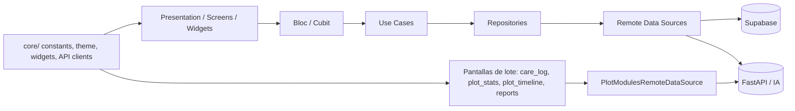
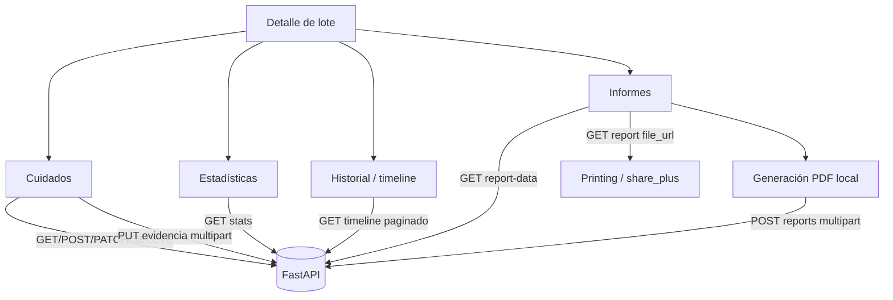
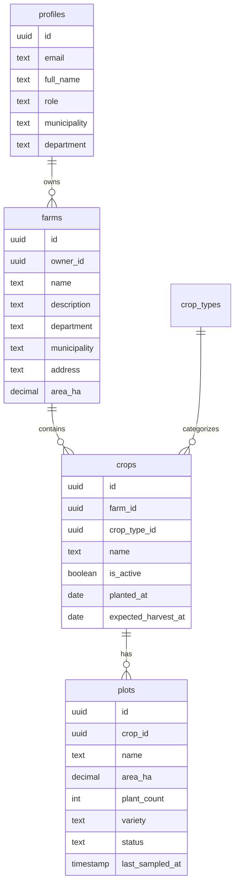

# Proyecto: Kroppi

## 1. Información general

### Nombre del proyecto
Kroppi

### Propósito y objetivos
Aplicación Flutter orientada al diagnóstico agronómico de cultivos mediante análisis de imágenes. El sistema está diseñado para permitir a un agricultor o técnico:

- autenticarse con correo/contraseña o Google,
- gestionar fincas, cultivos y lotes,
- programar o revisar monitoreos de parcelas,
- subir imágenes de plantas para diagnóstico asistido por IA,
- consultar historial de diagnósticos,
- registrar cuidados/labores aplicadas a cada lote (bitácora de cuidados),
- consultar estadísticas e historial cronológico (timeline) de cada lote,
- registrar cosechas y estimaciones de pérdidas por lote,
- generar, guardar y compartir informes PDF por lote,
- consultar guía estática de cultivos y perfil del usuario.

### Problema que busca resolver
El proyecto aborda la necesidad de facilitar la identificación de problemas fitosanitarios en cultivos a partir de imágenes tomadas en campo, reduciendo la dependencia de diagnósticos manuales o de expertos en tiempo real. La app integra autenticación, gestión de parcelas y análisis de imágenes con un backend de IA.

### Descripción general de funcionamiento
La app tiene una arquitectura de cliente móvil con navegación por rutas y gestión de estado por `flutter_bloc`/`Cubit`. El flujo principal es:

1. El usuario inicia sesión o se registra.
2. La sesión se valida en Supabase.
3. La pantalla principal muestra un dashboard con fincas y monitoreos pendientes.
4. El usuario puede consultar o crear fincas/cultivos/lotes.
5. Desde una parcela, puede iniciar un diagnóstico tomando una foto o seleccionando una imagen.
6. La imagen se envía al backend FastAPI para análisis con IA.
7. El resultado se presenta con nombre de enfermedad, nivel de confianza y recomendaciones.
8. Desde el detalle de un lote, el usuario accede a los módulos de Cuidados, Estadísticas, Historial (timeline), Cosechas, Pérdidas e Informes, con datos servidos por el backend FastAPI.

### Alcance actual del desarrollo
El repositorio refleja una aplicación funcional de frontend móvil con varios flujos implementados y una integración clara con Supabase y FastAPI. El alcance actual incluye:

- autenticación con Supabase,
- dashboard de inicio,
- gestión de fincas/cultivos/lotes,
- diagnóstico por imagen,
- muestreo por lote con cantidad de plantas configurable,
- historial de diagnósticos,
- bitácora de cuidados por lote (CRUD con evidencia fotográfica),
- registro y consulta de cosechas por lote,
- estimación de pérdidas por lote con vista de listado y formulario,
- estadísticas por lote con gráficas,
- timeline de eventos por lote,
- informes PDF por lote (generación local, subida al backend, visualización/impresión y compartir),
- vista general de lotes con filtros (todos / alerta / peligro),
- guía de cultivos,
- perfil de usuario.

El proyecto no contiene una base de datos local ni un backend propio dentro del repositorio; la persistencia y autenticación se resuelven con servicios externos.

---

## 2. Stack tecnológico

| Categoría | Tecnología | Observación |
|---|---|---|
| Lenguaje | Dart | Lenguaje principal del cliente Flutter |
| Framework | Flutter | App móvil multiplataforma |
| State management | flutter_bloc | Se usa en autenticación y diagnóstico |
| Navegación | go_router | Rutas y shell de navegación |
| HTTP client | Dio | Cliente centralizado para FastAPI |
| Auth / persistence | Supabase Flutter | Auth, sesión y acceso a tablas remotas |
| Google auth | google_sign_in | Inicio de sesión con Google |
| Selección de imágenes | image_picker | Cámara y galería |
| Modelado | equatable | Comparación de estados/entidades |
| Formularios y UI | Material 3 / widgets custom | Base visual del proyecto |
| Tipografía | google_fonts | Personalización visual |
| Gráficas | fl_chart | Estadísticas por lote (líneas y barras) |
| Internacionalización | flutter_localizations + intl | Locale `es`, formato de fechas en español |
| PDF | pdf + printing | Generación local de informes y visualización/impresión |
| Compartir | share_plus | Compartir informes PDF |
| Gestión de dependencias | pub | Flutter package manager |
| Linting | flutter_lints | Reglas de calidad | 

### Versiones identificables

- Flutter/Dart SDK: `^3.12.2` en `pubspec.yaml`
- Dependencias relevantes:
  - `dio: ^5.11.1`
  - `flutter_bloc: ^9.1.1`
  - `go_router: ^17.2.0`
  - `google_sign_in: ^7.2.0`
  - `supabase_flutter: ^2.18.0`
  - `image_picker: ^1.2.3`
  - `equatable: ^3.0.0`
  - `google_fonts: ^8.2.1`
  - `fpdart: ^1.2.0`
  - `http_parser: ^4.1.2`
  - `fl_chart: ^1.3.0`
  - `intl: ^0.20.2`
  - `pdf: ^3.13.1`
  - `printing: ^5.15.1`
  - `share_plus: ^13.3.1`
  - `flutter_localizations` (SDK)

### Dependencias principales y propósito

- `supabase_flutter`: autenticación, gestión de sesión y acceso a tablas de Supabase.
- `go_router`: manejo de rutas y navegación con shell.
- `flutter_bloc`: gestión del estado en autenticación, diagnóstico y otros flujos.
- `dio`: comunicación con el backend FastAPI.
- `image_picker`: selección o captura de imágenes para diagnóstico.
- `google_sign_in`: OAuth con Google.
- `equatable`: igualdad estructural de estados/entidades.
- `google_fonts`: estilo visual.
- `http_parser`: `MediaType` para subidas multipart (imágenes y PDF).
- `fl_chart`: gráficas de incidencia, cosecha, pérdidas e ingresos en `PlotStatsScreen`.
- `intl` / `flutter_localizations`: formato de fechas (`DateFormat`, `initializeDateFormatting('es')`) y localización Material en español.
- `pdf` / `printing`: construcción del informe PDF en el cliente y vista previa/impresión (`Printing.layoutPdf`).
- `share_plus`: compartir el PDF de un informe (`SharePlus.instance.share`).

Nota: añadir `printing` y `share_plus` modificó los registrantes de plugins nativos generados (`linux/`, `macos/`, `windows/`).

---

## 3. Arquitectura del proyecto

### Patrón arquitectónico utilizado
La aplicación sigue un enfoque de arquitectura feature-first con separación por responsabilidades dentro de cada módulo. La estructura más clara es:

- `features/<name>/data/`: fuentes de datos y repositorios.
- `features/<name>/domain/`: entidades, casos de uso y contratos de repositorio.
- `features/<name>/presentation/`: widgets, pantallas, BLoC/Cubit y lógica de UI.

También existe una capa compartida en `lib/core/` para utilidades e infraestructura común.

**Excepción — módulos de lote (`care_log`, `plot_stats`, `plot_timeline`, `harvests`, `loss_estimation`, `reports`, `plot_modules`):** la mayoría de estos módulos no siguen la separación completa data/domain/presentation. Las pantallas de `care_log`, `plot_stats`, `plot_timeline` y `reports` siguen usando acceso directo a `PlotModulesRemoteDataSource` y mapas crudos de FastAPI; `harvests` y `loss_estimation` sí incorporan una estructura más orientada a repositorios, entidades y formularios por feature. `plot_modules/data/` contiene únicamente el datasource compartido y el resto de lotes dependen de respuestas del backend o de repositorios inyectados.

### Organización de capas



### Responsabilidades por módulo

- `features/auth`: autenticación, registro y estado de sesión.
- `features/farms`: gestión de fincas, cultivos y lotes (incluye detalle de cultivo de finca, edición de lote con validación de área y vista general de lotes filtrable).
- `features/my_crops`: detalle de cultivos, muestreo y monitoreo; `PlotDetailScreen` enlaza a los módulos de lote.
- `features/plot_modules`: datasource compartido (`PlotModulesRemoteDataSource`) para cuidados, estadísticas, timeline e informes contra FastAPI.
- `features/care_log`: bitácora de cuidados por lote (listado filtrable, alta/edición, detalle, evidencia fotográfica).
- `features/plot_stats`: estadísticas del lote por rango de fechas y granularidad, con gráficas `fl_chart`.
- `features/plot_timeline`: línea de tiempo paginada de eventos del lote (muestreos, diagnósticos, cuidados, cosechas, pérdidas, informes).
- `features/harvests`: registro, listado y edición de cosechas por lote con validación de fechas y datos de producción.
- `features/loss_estimation`: cálculo y gestión de pérdidas por lote, con previsualización y persistencia en backend.
- `features/reports`: generación de informes PDF por periodo, listado, visualización, compartir y eliminación.
- `features/crop_diagnosis`: selección de imagen y análisis por IA.
- `features/history`: historial de diagnósticos y detalle.
- `features/home`: dashboard principal y sumarios.
- `features/profile`: configuración y edición de perfil.
- `features/guide`: catálogo de cultivos y guía contenido.
- `features/sampling`: flujo de muestreo y captura de datos.
- `navigation/`: rutas y shell principal para navegación.
- `core/`: clientes HTTP, guard de errores, refresh de datos, configuraciones, tema, widgets, errores y constantes.

### Comunicación entre componentes
La aplicación usa:

- `RepositoryProvider` para inyectar repositorios y servicios compartidos en `app.dart`.
- `BlocProvider` para mantener estados de autenticación, diagnóstico, cosechas y pérdidas.
- `GoRouter` para navegación entre pantallas y branches.
- `SupabaseClient` para acceder a tablas y auth.
- `FastApiClient` + `dioGuard()` para encapsular errores de la API y convertirlos en `Failure` del proyecto.
- `PlotModulesRemoteDataSource` (instanciado directamente en cada pantalla de los módulos de lote, no inyectado vía provider) sobre `FastApiClient.client`.
- `PlotDataRefreshNotifier` como mecanismo de notificación para recargar módulos del lote después de cambios en cosechas, pérdidas o reportes.
- `state.extra` de GoRouter para pasar objetos entre pantallas (p. ej. `FarmPlot` al editar lote, `Map` de la actividad al editar cuidado, `SamplingArgs` al iniciar muestreo, `reportId` inicial en el listado de informes).

### Principios de diseño observables

- feature-first modularization,
- separación de interfaces y repositorios,
- uso de casos de uso (`usecases`) para encapsular lógica de negocio,
- un cliente HTTP centralizado (`FastApiClient`),
- uso de `BLoC`/`Cubit` para estados relevantes,
- acceso a recursos externos por datasource para aislar la UI.

---

## 4. Estructura del repositorio

### Árbol de directorios principal

```text
cropguard/
├── .github/
│   └── modernize/
├── android/
├── assets/
│   └── images/          # auth_header.jpg, splash_bg.jpg
├── ios/
├── lib/
│   ├── core/
│   │   ├── network/
│   │   ├── refresh/
│   │   ├── utils/
│   │   └── widgets/
│   ├── features/
│   │   ├── care_log/
│   │   ├── crop_diagnosis/
│   │   ├── farms/
│   │   ├── harvests/
│   │   ├── history/
│   │   ├── loss_estimation/
│   │   ├── my_crops/
│   │   ├── plot_modules/
│   │   ├── plot_stats/
│   │   ├── plot_timeline/
│   │   ├── reports/
│   │   └── sampling/
│   ├── navigation/
│   ├── app.dart
│   └── main.dart
├── linux/
├── macos/
├── test/
├── web/
├── windows/
├── analysis_options.yaml
├── README.md
├── pubspec.yaml
├── pubspec.lock
├── CREATE_CONTEXT.md    # instrucciones para generar este documento
├── UPDATE_CONTEXT.md    # instrucciones para actualizar este documento
└── PROJECT_CONTEXT.md
```

### Descripción de carpetas principales

#### `lib/core/`
Contiene infraestructura compartida:

- `network/api/`: `FastApiClient`, interceptores, endpoints, `dio_guard.dart`, `api_error_message.dart` y servicios de backend.
- `network/supabase/`: cliente Supabase.
- `refresh/`: `PlotDataRefreshNotifier` para avisar a pantallas del lote que deben recargar datos tras cambios en cosechas, pérdidas u otros eventos.
- `theme/`: tema de la app.
- `constants/`: colores, textos, assets.
- `widgets/`: widgets reutilizables, incluidas vistas de vacío, estados del módulo y campos de formulario.
- `errors/`: excepciones y failures.
- `utils/`: utilidades de formato numérico y otros helpers.

#### `lib/features/`
Cada feature encapsula su propia lógica y UI:

- `auth/`
- `farms/`
- `crop_diagnosis/`
- `history/`
- `home/`
- `my_crops/`
- `profile/`
- `guide/`
- `sampling/`
- `plot_modules/` (solo `data/plot_modules_remote_data_source.dart`)
- `care_log/` (presentación para bitácora de cuidados)
- `plot_stats/` (estadísticas y widgets de gráficas)
- `plot_timeline/` (timeline del lote)
- `harvests/` (registro y edición de cosechas por lote)
- `loss_estimation/` (estimación de pérdidas, cálculo y listados)
- `reports/` (pantallas de informes PDF y configuración)

#### `lib/navigation/`
Define rutas y shell principal de navegación. La navegación se basa en `GoRouter` y `StatefulShellRoute.indexedStack` para la barra inferior.

#### `test/`
Incluye pruebas de la capa de autenticación y dashboard. Se ejecutan con `flutter_test`.

### Puntos de entrada

- `lib/main.dart`: inicializa el formato de fechas en español, `Supabase` y `FastApiClient`, luego ejecuta la app.
- `lib/app.dart`: crea providers y configura `MaterialApp.router` (locale `es`, delegados de localización).
- `lib/navigation/app_router.dart`: define la routing table.

### Archivos de configuración relevantes

- `pubspec.yaml`: dependencies, SDK y assets.
- `analysis_options.yaml`: reglas de análisis de Dart/Flutter.
- `android/`, `ios/`, `linux/`, `windows/`, `macos/`: configuraciones nativas de plataforma.

---

## 5. Funcionamiento interno

### Flujos principales de ejecución

#### A. Inicio de la aplicación
`main.dart` ejecuta:

```dart
WidgetsFlutterBinding.ensureInitialized();
await initializeDateFormatting('es');
await app_supabase.SupabaseClient.init();
FastApiClient.init();
runApp(const KroppiApp());
```

Esto garantiza que el formato de fechas en español, la sesión de Supabase y el cliente HTTP de FastAPI queden preparados antes de crear la UI.

#### B. Bootstrap de proveedores y app
`app.dart` crea varios `RepositoryProvider` y `BlocProvider`:

- `AnalyzeCropImageUsecase`
- `MyCropsRemoteDataSource`
- `FarmRemoteDataSource`
- `AuthBloc` con casos de uso de login/registro/sesión/cierre

`MaterialApp.router` fija `locale: Locale('es')`, soporta `es` y `en` y registra los delegados `GlobalMaterialLocalizations`, `GlobalWidgetsLocalizations` y `GlobalCupertinoLocalizations` (necesarios, entre otros, para `showDatePicker`/`showDateRangePicker` en español). En pantallas anchas (web/escritorio) el `builder` envuelve la app en un marco de teléfono de 390×844 que ahora se ajusta con `LayoutBuilder` a las restricciones disponibles y reescribe `MediaQuery.size` con el tamaño del marco.

#### C. Autenticación
El flujo se apoya en `AuthBloc` y `SupabaseAuthService`:

- `AuthSessionCheckRequested`: valida si existe una sesión activa.
- `AuthGoogleSignInRequested`: abre flujo de Google OAuth con Supabase.
- `AuthEmailSignInRequested`: inicia sesión con email/contraseña.
- `AuthEmailSignUpRequested`: crea usuario con metadata adicional.
- `AuthSignOutRequested`: cierra sesión y limpia Google.

Cuando la sesión es válida, la app entra al shell principal de navegación.

#### D. Dashboard y fincas
`HomeCubit` carga el dashboard usando `FarmRemoteDataSource.getDashboard()`. El dashboard calcula:

- número total de fincas,
- número total de lotes,
- alertas y peligros,
- monitoreos pendientes por parcela.

Cada `HomePendingSampling` incluye ahora `cropSlug` (resuelto desde `crop_types.slug`, por defecto `cafe`) y `plantCount`, que se envían como `SamplingArgs` al iniciar el muestreo desde el home. Las tarjetas de `HomeSummary` son navegables: fincas → `/farms`, lotes → `/plots`, alertas → `/plots/alerts`, peligro → `/plots/danger`.

`PlotsOverviewScreen` (`features/farms`) carga todas las fincas y sus detalles (`getFarms` + `getFarmDetails` por finca), lista los lotes de cultivos activos, filtra por salud (`FarmPlotHealth.alert` / `danger`) y pagina en el cliente.

#### D.1 Gestión de lotes y validación de área
- `FarmRemoteDataSource.updateFarmPlot` permite editar nombre, área, número de plantas y variedad de un lote (`plots`), filtrando por `id` y `crop_id`.
- `createFarmPlot` y `updateFarmPlot` validan con `_validatePlotArea` que la suma de áreas de los lotes no supere `farms.area_ha` (si la finca tiene área definida); se lanza `StateError` con el área disponible.
- `updateFarm` rechaza reducir el área de la finca por debajo del área ocupada por sus lotes.
- `PlotFormScreen` funciona en modo alta o edición (`plot: FarmPlot?`), consulta y muestra el área disponible de la finca y la valida en el formulario.
- `FarmCropDetailScreen` (`/farms/:farmId/crops/:cropId`) muestra el detalle de un cultivo de la finca con acceso a sus lotes.
- `FarmPlotDetailScreen` recibe ahora `farmId`, `cropId` y `plotId`; ofrece edición del lote y enlaces a Cuidados, Estadísticas, Historial e Informes.
- `FarmDetailScreen` permite abrir el detalle de cultivo, editar un lote e iniciar muestreo directamente desde la tarjeta del lote.

#### D.2 Muestreo
`SamplingScreen` muestra primero una pantalla "Preparar muestreo" donde el usuario indica cuántas plantas diagnosticar. `SamplingCubit.configureTarget(int)` acepta valores entre 1 y `plantCount` del lote (si existe). `SamplingArgs.target` es solo la sugerencia inicial (mín(plantas, 20); 20 si no hay dato o es < 1) y `canScan` deja de permitir escaneos al alcanzar la meta elegida o el tope de plantas.

#### E. Diagnóstico por imagen
El flujo de diagnóstico usa:

- `DiagnosisScreen` para capturar/seleccionar foto,
- `ImagePickerService` para abrir la cámara o galería,
- `DiagnosisBloc` para manejar estados (`loading`, `success`, `error`),
- `AnalyzeCropImageUsecase` para invocar el repositorio,
- `CropDiagnosisRepositoryImpl` para coordinar con `FastApiClient`.

La imagen se envía con `MultipartFile` y el backend debe responder con un resultado estructurado.

#### F. Historias de uso, perfil y guía
La app también incluye:

- `history`: listado y detalle de diagnósticos,
- `guide`: información estática por cultivos,
- `profile`: edición de perfil personal,
- `sampling`: procesamiento de muestreos y seguimiento por parcela.

#### G. Módulos de lote (FastAPI)
Accesibles desde `PlotDetailScreen` y `FarmPlotDetailScreen`. Todas las pantallas usan `PlotModulesRemoteDataSource` y muestran errores con `apiErrorMessage`.

- **Cuidados (`care_log`)**: `CareListScreen` lista actividades paginadas de 50 en 50 con filtro por tipo; `CareFormScreen` crea (POST) o edita (PATCH) una actividad con los campos `applied_at`, `activity_type`, `product_name`, `active_ingredient`, `quantity`, `quantity_unit`, `application_method`, `target_disease_code`, `cost`, `notes`, y opcionalmente sube una foto de evidencia (PUT multipart); `CareDetailScreen` muestra la actividad, permite editarla, eliminarla y eliminar su evidencia. Tipos (`careTypes`): `FERTILIZATION`, `FUNGICIDE`, `INSECTICIDE`, `HERBICIDE`, `PRUNING`, `WEEDING`, `IRRIGATION`, `CULTURAL_CONTROL`, `OTHER`. Métodos (`careMethods`): `SPRAYING`, `DRENCH`, `BROADCAST`, `MANUAL`, `DRIP`, `OTHER`.
- **Estadísticas (`plot_stats`)**: `PlotStatsScreen` consulta `/plots/{id}/stats` con rango de fechas (`showDateRangePicker`) y granularidad (por defecto `month`). Muestra totales (muestreos, incidencia promedio/máxima, kg cosechados, ingresos, pérdidas, costo de cuidados en COP) y gráficas de incidencia con umbrales `alert_pct`/`danger_pct`, plantas afectadas, evolución de salud, desglose de enfermedades, cosecha, pérdidas e ingresos.
- **Historial (`plot_timeline`)**: `PlotTimelineScreen` consulta `/plots/{id}/timeline` con paginación por cursor (`before` → `next_before`) y filtro por tipos (`sample`, `diagnosis`, `care`, `harvest`, `loss`, `report`). Agrupa por mes y navega al detalle de cuidado, al informe o al diagnóstico según el tipo; cosechas y pérdidas se muestran en una hoja inferior.
- **Informes (`reports`)**: `ReportSetupScreen` obtiene `/plots/{id}/report-data` para un periodo, descarga fotos de muestreo y evidencias (URLs firmadas), **construye el PDF en el cliente** con el paquete `pdf` y lo sube a `/plots/{id}/reports` (multipart con `period_from`, `period_to`, `file`). Si la subida falla, el PDF sigue disponible para ver/compartir. `ReportsListScreen` lista informes, los abre con `Printing.layoutPdf`, los comparte con `share_plus` (descargando `file_url`) y permite eliminarlos.



### Tratamiento de errores
El proyecto tiene manejo de errores estructurado en `lib/core/errors/failures.dart`. La lógica de red define tipos de fallo para:

- red,
- autenticación,
- no encontrado,
- errores del servidor.

También se usan excepciones de `Dio` y `AuthException` para comunicar fallos de backend o sesión. Los módulos de lote usan `apiErrorMessage()` (`lib/core/network/api/api_error_message.dart`) para convertir `DioException` en mensajes legibles, y las validaciones de área en `FarmRemoteDataSource` lanzan `StateError` con mensajes en español.

---

## 6. Base de datos y persistencia

### Motor de base de datos
El repositorio no contiene migraciones SQL ni un esquema de base de datos local. La persistencia primaria se hace mediante Supabase, que usa PostgreSQL en la nube.

### Entidades y tablas observadas en el código
Los nombres que aparecen explícitamente en el código son:

- `profiles`
- `farms`
- `crops`
- `crop_types`
- `plots`

También se usa la autenticación de Supabase y la sesión de usuario actual:

- `auth.currentUser`
- `auth.onAuthStateChange`

### Relaciones y patrones identificados

- Cada finca tiene `owner_id` y se filtra por usuario autenticado.
- Cada cultivo pertenece a una `farm_id`.
- Cada lote pertenece a un `crop_id`.
- El perfil del usuario se guarda en `public.profiles` y se crea a partir de la metadata que llega durante el registro.

### Estructura conceptual



### Operaciones de lectura y escritura
El código demuestra estas operaciones:

- `FarmRemoteDataSource.createFarm`, `updateFarm`, `getFarms`, `getFarmDetails`, `getFarmCrop`, `getFarmPlot`.
- `createCrop`, `updateCrop`, `createFarmPlot`, `updateFarmPlot` (con validación de área disponible de la finca).
- `getDashboard` agrega estadísticas desde fincas y lotes; ahora también lee `crops.crop_type_id`, `crop_types.slug` y `plots.plant_count` para alimentar el muestreo desde el home.
- Los datos de cuidados, estadísticas, timeline, cosechas, pérdidas e informes **no se consultan directamente en Supabase** desde el cliente; se obtienen vía FastAPI (ver sección 7). Su esquema de tablas no es visible en este repositorio.
- `AuthRemoteDataSource`/`SupabaseAuthService` usan `signInWithEmail`, `signUp`, y `signInWithIdToken`.

### Evidencia de migraciones y esquema
No se encontraron migraciones SQL dentro del repositorio. No hay archivos de esquema versionado en la carpeta raíz. El modelo de datos queda definido por la firma de llamadas a Supabase y por los objetos de dominio del cliente.

---

## 7. APIs e integraciones

### Supabase
La app usa Supabase para:

- autenticación,
- sesión del usuario,
- almacenamiento de perfiles,
- gestión de fincas, cultivos y lotes,
- queries filtradas por `owner_id` / `user_id`.

#### Cliente inicializado
`lib/core/network/supabase/supabase_client.dart` define:

- URL base de Supabase,
- publishable key,
- `Supabase.initialize(...)`.

Esto indica que la app tiene una integración directa con un proyecto Supabase específico.

### FastAPI / backend de diagnóstico
La app define endpoints en `lib/core/network/api/api_endpoints.dart`:

- `GET /health`
- `POST /diagnoses`
- `GET /diagnoses`
- `GET /diagnoses/{diagnostico_id}`

La lógica de comunicación de diagnósticos se encuentra en `AiBackendService`.

#### Endpoints de módulos de lote
Definidos en `ApiEndpoints` y consumidos por `PlotModulesRemoteDataSource` (`lib/features/plot_modules/data/`):

| Método | Endpoint | Uso en el cliente |
|---|---|---|
| GET | `/plots/{plotId}/care-activities?limit=50&offset=&type=` | `getCare` |
| POST | `/plots/{plotId}/care-activities` | `saveCare` (alta) |
| GET | `/care-activities/{activityId}` | `getCareById` |
| PATCH | `/care-activities/{activityId}` | `saveCare` (edición) |
| DELETE | `/care-activities/{activityId}` | `deleteCare` |
| PUT | `/care-activities/{activityId}/evidence` | `uploadCareEvidence` (multipart `file`, png/webp/jpeg) |
| DELETE | `/care-activities/{activityId}/evidence` | `deleteCareEvidence` |
| GET | `/plots/{plotId}/stats?from=&to=&granularity=` | `getStats` (fechas `yyyy-MM-dd`) |
| GET | `/plots/{plotId}/timeline?limit=&before=&types=` | `getTimeline` (`types` separados por coma) |
| GET | `/plots/{plotId}/report-data?from=&to=` | `getReportData` |
| GET | `/plots/{plotId}/reports` | `getReports` |
| POST | `/plots/{plotId}/reports` | `uploadReport` (multipart `period_from`, `period_to`, `file` PDF) |
| GET | `/reports/{reportId}` | `getReport` (devuelve `file_url`) |
| DELETE | `/reports/{reportId}` | `deleteReport` |

Campos de respuesta usados por la UI (observados en el código, no en un contrato formal):

- stats: `totals`, `incidence_series`, `health_evolution`, `disease_breakdown`, `harvest_series`, `loss_series`, `income_series`, `thresholds` (`alert_pct`, `danger_pct`), `harvests_without_price`.
- timeline: `items[]` (`id`, `type`, `occurred_at`, `title`, `subtitle`, `severity`, `data`, `ref`), `next_before`.
- report-data: `identification` (`farm`, `crop`, `plot`), `period`, `samples`, `sample_photos[].signed_url`, `disease_breakdown`, `care_activities[].evidence_url`, `harvests`, `production`, `losses`, `conclusions`, `chart_series`.
- reports: `id`, `period_from`, `period_to`, `created_at`, `file_size_bytes`, `summary`, `file_url`.

`downloadFile(url)` usa una instancia nueva de `Dio` (sin interceptores ni token) para descargar archivos desde URLs firmadas.

#### Contrato observado
- `createDiagnosis`: envía `multipart/form-data` con:
  - `file` (obligatorio),
  - `crop_slug` (opcional, por defecto `cafe`),
  - `plot_id` (opcional),
  - `latitude` y `longitude` (opcionales pero deben ir juntos).
- `getDiagnoses`: consulta paginada con `limit` y `offset`.
- `getDiagnosisById`: consulta por UUID del diagnóstico.
- `send`: método genérico para otras llamadas.

### Integraciones externas

- Google OAuth para login.
- Supabase Auth para sesión y perfiles.
- FastAPI para análisis agrícola/IA y para los módulos de cuidados, estadísticas, timeline e informes.
- `image_picker` para imágenes desde cámara o galería (diagnóstico y evidencia de cuidados).
- `printing` / `share_plus` para visualizar, imprimir y compartir PDF mediante las capacidades nativas del sistema.

### Observación importante
La documentación del backend y del esquema real del servidor no está dentro del repositorio. La app asume un contrato de API externo que se debe validar contra el backend en ejecución.

---

## 8. Seguridad

### Autenticación
La app implementa autenticación basada en:

- email/contraseña con Supabase,
- Google OAuth con `google_sign_in` + Supabase `signInWithIdToken`.

El flujo de registro usa metadata adicional para completar el perfil del usuario, tal como `full_name`, `phone_number`, `municipality`, `department`, `role`.

### Autorización
El código filtra datos por usuario autenticado, por ejemplo:

- `.eq('owner_id', userId)` en `FarmRemoteDataSource`
- validación de la sesión actual antes de consultar las fincas o lotes

Esto sugiere políticas de acceso basadas en el usuario autenticado, normalmente reforzadas por RLS de Supabase.

### Protección de información
Observaciones:

- No se almacenan secretos dentro del repo en texto plano del tipo `client_secret`.
- El cliente Supabase y la URL base aparecen hardcoded en `supabase_client.dart`, pero este valor es la clave publishable del proyecto, no un secreto crítico del lado del servidor.
- Los IDs OAuth se configuran mediante `String.fromEnvironment`:
  - `GOOGLE_WEB_CLIENT_ID`
  - `GOOGLE_IOS_CLIENT_ID`

### Variables de entorno relacionadas con seguridad
Nombre esperado por código:

- `GOOGLE_WEB_CLIENT_ID`
- `GOOGLE_IOS_CLIENT_ID`

El README documenta que los valores de Google OAuth deben mantenerse fuera del repositorio.

### Validaciones aplicadas
- validación de longitud de imagen (`10 MB máximo` en `AiBackendService`),
- validación de sesión antes de consultas,
- validación de área de lotes frente al área de la finca (cliente y `FarmRemoteDataSource`),
- validación de cantidad de plantas a muestrear (1 ≤ n ≤ plantas del lote),
- validación de rango de fechas en informes (fecha inicial anterior a la final),
- las descargas de fotos/PDF usan URLs firmadas entregadas por el backend, sin enviar el token de la app,
- manejo de errores HTTP (`401`, `403`, `404`, etc.),
- sanitización mínima de textos en `trim()` y manejo de valores nulos.

---

## 9. Instalación y ejecución

### Requisitos previos

- Flutter SDK instalado.
- Dart compatible con la versión `^3.12.2`.
- Editor compatible (VS Code, Android Studio, etc.).
- Dependencia de backend externo (Supabase + FastAPI).

### Instalación
```bash
cd cropguard
flutter pub get
```

### Ejecución
```bash
flutter run
```

### Análisis estático
```bash
flutter analyze
```

### Pruebas
```bash
flutter test
```

### Configuración de entorno
Para Google OAuth, el README indica que se usa un valor en tiempo de compilación, por ejemplo:

```bash
flutter run --dart-define=GOOGLE_WEB_CLIENT_ID=tu-id-web.apps.googleusercontent.com
```

Y para iOS:

```bash
flutter run --dart-define=GOOGLE_IOS_CLIENT_ID=tu-id-ios.apps.googleusercontent.com
```

### Desarrollo vs producción
El proyecto no incluye una estrategia de entornos formal en el repo. La configuración actual es más bien de desarrollo local y de integración con proyectos externos. La app se conecta a un Supabase y un backend FastAPI específicos, y esos endpoints/credenciales deben validar su correspondencia con el entorno real.

---

## 10. Pruebas y calidad

### Pruebas existentes
El repositorio incluye varias pruebas con `flutter_test`:

- `test/features/auth/presentation/bloc/auth_bloc_test.dart`
- `test/features/home/domain/entities/home_dashboard_test.dart`

### Estado verificado
Se ejecutó la suite de pruebas con el comando:

```bash
flutter test --reporter expanded
```

Resultado observado (re-verificado el 2026-11-07 con `flutter test`):

- 12 tests ejecutados
- todos aprobados
- salida final: `All tests passed!`

Los nuevos módulos (`care_log`, `plot_stats`, `plot_timeline`, `reports`, `plot_modules`), la validación de área de lotes y la configuración de meta de muestreo **no tienen pruebas**.

### Calidad estática
El repositorio usa `flutter_lints` vía `analysis_options.yaml`. `flutter analyze` (2026-11-07): `No issues found!`.

### Problemas o advertencias conocidas
- **Resuelto:** el warning `unable to find directory entry in pubspec.yaml: .../assets/images/crops/` ya no aplica; `pubspec.yaml` declara ahora `assets/images/`, carpeta que existe (contiene `auth_header.jpg` y `splash_bg.jpg`).
- `PlotModulesRemoteDataSource` usa la sintaxis de elementos nulos en colecciones (`'type': ?type`), que requiere un SDK de Dart reciente (compatible con el `^3.12.2` declarado).

---

## 11. Estado actual del proyecto

### Funcionalidades implementadas

- autenticación con email y Google,
- sesión persistente y comprobación inicial,
- dashboard principal con fincas y monitoreos pendientes,
- registro y edición de fincas,
- registro de cultivos y lotes,
- edición de lotes con validación de área disponible en la finca,
- vistas de detalle de fincas, cultivos de finca y lotes,
- vista general de lotes con filtros de alerta/peligro accesible desde el home,
- diagnóstico de cultivos por imagen,
- muestreo con cantidad de plantas configurable por sesión,
- historial de diagnósticos,
- bitácora de cuidados por lote (CRUD + evidencia fotográfica),
- registro, listado y edición de cosechas por lote,
- cálculo y gestión de pérdidas estimadas por lote,
- estadísticas por lote con gráficas,
- timeline de eventos por lote con filtros y paginación,
- informes PDF por lote (generar, guardar en backend, ver/imprimir, compartir, eliminar),
- localización en español (fechas y widgets Material),
- guía de cultivos,
- edición de perfil,
- navegación basada en rutas y shell.

### Funcionalidades parcialmente implementadas o dependientes de backend

- integración real con FastAPI depende de que el backend esté corriendo y disponible (incluidos los endpoints de cuidados, stats, timeline, report-data, reports, cosechas y pérdidas),
- los módulos del lote `harvests` y `loss_estimation` existen como flujo funcional en la app y usan repositorios con validación de errores, pero requieren que el backend exponga y mantenga la estructura correcta de datos y reglas de negocio,
- los módulos de lote trabajan con `Map` crudos en varios puntos del acceso a FastAPI, aunque se han consolidado validaciones con `dioGuard()` y `Failure` para mejorar la resiliencia,
- ciertos flujos de detalle/monitoreo requieren que la base de datos Supabase tenga la estructura correcta,
- pantallas como `notifications` y `help` quedan como placeholders,
- no hay evidencia de un backend del proyecto dentro del repositorio.

### Funcionalidades pendientes

- definición y versionado completo del esquema de base de datos del backend,
- pruebas de integración con Supabase y FastAPI,
- validación de flujos end-to-end con credenciales reales,
- cobertura más amplia de tests de UI,
- pruebas para los módulos de lote, la validación de área y el muestreo configurable,
- refactor de los módulos de lote a data/domain/presentation con BLoC/Cubit, si se quiere mantener la convención del resto de features,
- configuración de entorno para producción o múltiples entornos.

### Limitaciones y deuda técnica identificable

- El esquema de la base de datos no está versionado en el repositorio.
- El proyecto no presenta una organización de backend propia dentro del código fuente.
- Las rutas de activos y configuración externa necesitan validación con el entorno real.
- La documentación del backend y contratos reales debería validarse contra la API en ejecución.
- Los módulos de lote no siguen la arquitectura por capas: `PlotModulesRemoteDataSource` se instancia dentro de cada pantalla (no se inyecta), lo que dificulta pruebas y mocks.
- `PlotsOverviewScreen` hace una llamada `getFarmDetails` por finca (N+1 consultas) y pagina en memoria.
- La validación de área se hace en el cliente (lectura + escritura no atómicas); debería reforzarse en la base de datos/backend.

---

## 12. Guía para futuros desarrolladores y asistentes de IA

### Cómo empezar a trabajar
1. Leer esta guía y la documentación del README.
2. Revisar `lib/main.dart` y `lib/app.dart` para entender bootstrap.
3. Estudiar `lib/navigation/app_router.dart` para entender las rutas principales.
4. Revisar la feature objetivo en `lib/features/` según la tarea.
5. Mantener la separación por capas data/domain/presentation.

### Dónde implementar nuevas funcionalidades

- nuevas pantallas: `lib/features/<feature>/presentation/screens/`
- modelos y entidades: `lib/features/<feature>/domain/entities/`
- casos de uso: `lib/features/<feature>/domain/usecases/`
- acceso a datos: `lib/features/<feature>/data/datasources/` y `repositories/`
- configuración compartida: `lib/core/`
- rutas de navegación: `lib/navigation/app_routes.dart` + `app_router.dart`
- nuevos endpoints de FastAPI: `lib/core/network/api/api_endpoints.dart`; si son del ámbito de lote, añadir el método en `PlotModulesRemoteDataSource`

### Rutas añadidas (resumen)

| Ruta | Pantalla |
|---|---|
| `/farms/:farmId/crops/:cropId` | `FarmCropDetailScreen` |
| `/farms/:farmId/crops/:cropId/plots/:plotId/edit` | `PlotFormScreen` (edición, `extra: FarmPlot`) |
| `/plots`, `/plots/alerts`, `/plots/danger` | `PlotsOverviewScreen` (filtro `all` / `alert` / `danger`) |
| `/plots/:plotId/care` | `CareListScreen` |
| `/plots/:plotId/care/new` | `CareFormScreen` |
| `/plots/:plotId/care/:activityId` | `CareDetailScreen` |
| `/plots/:plotId/care/:activityId/edit` | `CareFormScreen` (`extra: Map`) |
| `/plots/:plotId/stats` | `PlotStatsScreen` |
| `/plots/:plotId/timeline` | `PlotTimelineScreen` |
| `/plots/:plotId/harvests` | `HarvestListScreen` |
| `/plots/:plotId/harvests/new` | `HarvestFormScreen` |
| `/plots/:plotId/loss` | `LossListScreen` |
| `/plots/:plotId/loss/new` | `LossFormScreen` |
| `/plots/:plotId/reports` | `ReportsListScreen` (`extra: String?` id inicial) |
| `/plots/:plotId/reports/new` | `ReportSetupScreen` |

Estas rutas se declaran en el nivel raíz del `GoRouter` (fuera del `StatefulShellRoute` de pestañas).

**Orden de rutas:** `/plots`, `/plots/alerts` y `/plots/danger` se declaran antes de `/plots/:plotId`, porque GoRouter usa la primera coincidencia (antes `/plots/danger` se resolvía como un `plotId`; corregido el 2026-11-07).

### Convenciones observadas

- Cada feature separa datos, dominio y presentación.
- La lógica de negocio se encapsula en use cases.
- El manejo de estado usa `BLoC` o `Cubit`.
- La navegación se define centralmente en `GoRouter`.
- Las integraciones con servicios externos quedan detrás de datasources.

### Dependencias importantes entre módulos

- `AuthBloc` influye en la navegación y la sesión de la app.
- `HomeCubit` y `FarmRemoteDataSource` alimentan el dashboard principal.
- `DiagnosisScreen` se asocia a `AnalyzeCropImageUsecase` y a `FastApiClient`.
- `AppRouter` crea `BlocProvider`s específicos por pantalla.
- `FarmRemoteDataSource` se usa tanto para la vista de fincas como para la pantalla principal y `PlotsOverviewScreen`.
- `PlotModulesRemoteDataSource` es compartido por `care_log`, `plot_stats`, `plot_timeline`, `harvests`, `loss_estimation` y `reports`; `PlotTimelineScreen` navega hacia pantallas de `care_log`, `reports`, `history`, `harvests` y `loss_estimation`.
- `HarvestRepository` y `LossRepository` se inyectan a través de `RepositoryProvider` para manejar las pantallas de cosechas y pérdidas del lote.
- `PlotDataRefreshNotifier` se usa para recargar listas y paneles del lote tras guardar o eliminar cosechas y pérdidas.
- `HomeScreen`, `FarmDetailScreen`, `FarmCropDetailScreen` y `PlotDetailScreen` construyen `SamplingArgs` (de `features/sampling`) para iniciar muestreos.

### Consideraciones importantes para evitar romper funcionalidad

- no alterar la estructura de rutas sin actualizar `AppRoutes` y `AppRouter`;
- no romper la relación entre `AuthBloc` y la sesión de Supabase;
- no cambiar el contrato de `AiBackendService` sin revisar el backend y los `DiagnosisBloc` que lo consumen;
- los módulos de lote leen claves de `Map` por nombre (`totals`, `items`, `next_before`, `identification`, etc.); cualquier cambio en las respuestas de FastAPI rompe estas pantallas en tiempo de ejecución, no de compilación;
- al añadir rutas bajo `/plots/...`, declarar las rutas estáticas antes que las paramétricas;
- mantener la filtración por usuario autenticado en consultas a Supabase;
- no introducir secretos en el repositorio; usar `String.fromEnvironment` o variables de entorno,
- validar con `flutter analyze` y `flutter test` antes de cerrar cambios funcionales.

---

## Resumen ejecutivo

Kroppi es una aplicación Flutter de diagnóstico agronómico que combina autenticación con Supabase, gestión de fincas y análisis visual de cultivos con un backend FastAPI. Además incorpora módulos por lote para bitácora de cuidados, estadísticas, timeline, cosechas, estimación de pérdidas e informes PDF, todos servidos por FastAPI o por repositorios del cliente con integración a la API. La arquitectura está organizada por features, con una clara separación entre presentación, dominio y acceso a datos. El repositorio actual muestra una base funcional y bien estructurada, con una integración concreta con Supabase y con la capa de IA, además de capas específicas para validación de errores y actualización de datos del lote, aunque la validación del backend real y la definición del esquema externo siguen siendo responsabilidad del entorno de ejecución y no del repositorio.

La documentación de este archivo debería ser suficiente como contexto de referencia para continuar el desarrollo de la app o para dar continuidad a asistentes de IA sin tener que releer todo el código fuente desde cero.

---

## Historial de actualizaciones

### 2026-11-07 — Módulos de lote y mejoras de gestión de lotes
Cambios verificados entre el commit `7f27542` (creación de este documento) y `3f290d3` ("new modules creation").

**Resumen**
- Se documentan los nuevos módulos por lote servidos por FastAPI: cuidados, estadísticas, timeline e informes PDF.
- Se documentan la edición de lotes con validación de área, la vista general de lotes filtrable y el muestreo con meta configurable.
- Se actualiza el stack con las nuevas dependencias y la localización en español.

**Nuevos componentes / funcionalidades**
- `lib/features/plot_modules/data/plot_modules_remote_data_source.dart`.
- `lib/features/care_log/` (`care_list_screen`, `care_form_screen`, `care_detail_screen`, `care_labels`).
- `lib/features/plot_stats/presentation/screens/plot_stats_screen.dart`.
- `lib/features/plot_timeline/presentation/screens/plot_timeline_screen.dart`.
- `lib/features/reports/presentation/screens/` (`report_setup_screen`, `reports_list_screen`).
- `lib/features/farms/presentation/screens/farm_crop_detail_screen.dart` y `plots_overview_screen.dart`.
- `lib/core/network/api/api_error_message.dart`.
- 8 constructores de endpoint nuevos en `ApiEndpoints` (14 combinaciones método/endpoint) y 13 rutas nuevas en `AppRoutes`/`AppRouter`.
- Dependencias: `fl_chart`, `intl`, `flutter_localizations`, `pdf`, `printing`, `share_plus`.

**Componentes modificados**
- `main.dart` (`initializeDateFormatting('es')`) y `app.dart` (locale/delegados, marco de teléfono adaptable).
- `FarmRemoteDataSource` (`updateFarmPlot`, `_validatePlotArea`, validación en `updateFarm`, slug de cultivo y `plant_count` en el dashboard).
- `HomeDashboard`/`HomePendingSampling` (`cropSlug`, `plantCount`), `HomeScreen`, `HomeSummary` (tarjetas navegables).
- `PlotFormScreen` (modo edición, área disponible), `PlotDetailScreen`, `FarmDetailScreen`, `FarmPlotDetailScreen` (enlaces a módulos).
- `SamplingCubit`/`SamplingScreen` (`configureTarget`, pantalla "Preparar muestreo").
- `pubspec.yaml`: assets pasan de `assets/images/crops/` a `assets/images/`.
- Registrantes de plugins nativos generados (`linux/`, `macos/`, `windows/`).

**Componentes eliminados**
- Ninguno.

**Correcciones**
- Se retira el warning del asset `assets/images/crops/` (resuelto).
- Se corrige la errata "configuraiones".

**Hallazgos registrados**
- Conflicto de orden entre `/plots/:plotId` y `/plots/alerts`/`/plots/danger` (confirmado y corregido después en la misma fecha).
- Los nuevos módulos no siguen la arquitectura por capas y no tienen pruebas.

**Validación**
- `flutter test`: 12/12 tests aprobados.
- `flutter analyze`: sin problemas.

**Secciones afectadas**
1 (Información general), 2 (Stack), 3 (Arquitectura), 4 (Estructura), 5 (Funcionamiento interno: B, D, D.1, D.2, G y errores), 6 (Persistencia), 7 (APIs), 8 (Seguridad/validaciones), 10 (Pruebas), 11 (Estado), 12 (Guía) y Resumen ejecutivo.

### 2026-11-07 — Cosechas, pérdidas y refinamiento de errores del backend
Cambios verificados en el estado actual del repositorio.

**Resumen**
- Se incorporan los módulos de `harvests` y `loss_estimation` a la arquitectura del lote.
- Se documentan nuevos repositorios, validaciones y rutas del detalle del lote.
- Se actualiza la capa de red con `dioGuard()` para normalizar errores HTTP y de conexión en `Failure`.
- Se añade un notificador de refresco compartido para re-cargar pantallas del lote tras cambios de estado.

**Nuevos componentes / funcionalidades**
- `lib/features/harvests/` con repositorio, entidades, formularios y listados de cosechas.
- `lib/features/loss_estimation/` con previsualización, listado, edición y cálculo de pérdidas.
- `lib/core/network/api/dio_guard.dart` y `core/errors/failures.dart` como capa de errores centralizada.
- `lib/core/refresh/plot_data_refresh.dart` para sincronizar pantallas del lote.
- Nuevas rutas de `AppRoutes` para `/plots/:plotId/harvests`, `/plots/:plotId/harvests/new`, `/plots/:plotId/loss` y `/plots/:plotId/loss/new`.

**Componentes modificados**
- `lib/app.dart` para inyectar `HarvestRepository` y `LossRepository`.
- `lib/navigation/app_router.dart` para registrar flujos de cosechas y pérdidas.
- `lib/navigation/app_routes.dart` con rutas del módulo de lote.
- `pubspec.yaml` y el proyecto de Flutter siguen definiendo el stack actual con `flutter_bloc`, `go_router`, `supabase_flutter`, `pdf` y `share_plus`.

**Secciones de documentación afectadas**
- Información general, alcance del proyecto y flujo de operación.
- Arquitectura, estructura de carpetas y dependencias entre módulos.
- Rutas y listados de pantallas del lote.
- Estado actual e hitos funcionales del frontend.
