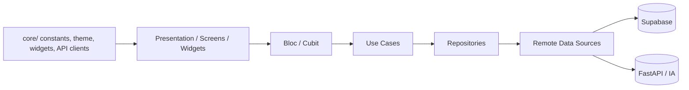
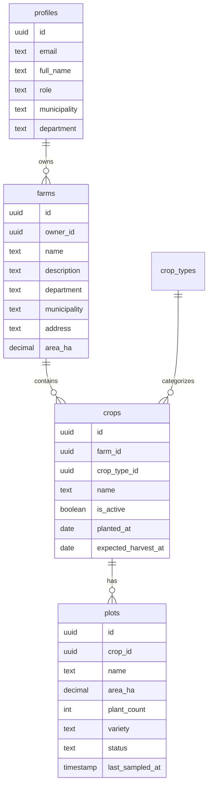

# Proyecto: Kroppi

## 1. Información general

### Nombre del proyecto
Kroppi

### Propósito y objetivos
Aplicación Flutter orientada al diagnóstico agronómico de cultivos mediante análisis de imágenes. El sistema está diseñado para permitir a un agricultor o técnico:

- autenticarse con correo/contraseña o Google,
- gestionar fincas, cultivos y lotes,
- programar o revisar monitoreos de parcelas,
- subir imágenes de plantas para diagnóstico asistido por IA,
- consultar historial de diagnósticos,
- consultar guía estática de cultivos y perfil del usuario.

### Problema que busca resolver
El proyecto aborda la necesidad de facilitar la identificación de problemas fitosanitarios en cultivos a partir de imágenes tomadas en campo, reduciendo la dependencia de diagnósticos manuales o de expertos en tiempo real. La app integra autenticación, gestión de parcelas y análisis de imágenes con un backend de IA.

### Descripción general de funcionamiento
La app tiene una arquitectura de cliente móvil con navegación por rutas y gestión de estado por `flutter_bloc`/`Cubit`. El flujo principal es:

1. El usuario inicia sesión o se registra.
2. La sesión se valida en Supabase.
3. La pantalla principal muestra un dashboard con fincas y monitoreos pendientes.
4. El usuario puede consultar o crear fincas/cultivos/lotes.
5. Desde una parcela, puede iniciar un diagnóstico tomando una foto o seleccionando una imagen.
6. La imagen se envía al backend FastAPI para análisis con IA.
7. El resultado se presenta con nombre de enfermedad, nivel de confianza y recomendaciones.

### Alcance actual del desarrollo
El repositorio refleja una aplicación funcional de frontend móvil con varios flujos implementados y una integración clara con Supabase y FastAPI. El alcance actual incluye:

- autenticación con Supabase,
- dashboard de inicio,
- gestión de fincas/cultivos/lotes,
- diagnóstico por imagen,
- historial de diagnósticos,
- guía de cultivos,
- perfil de usuario.

El proyecto no contiene una base de datos local ni un backend propio dentro del repositorio; la persistencia y autenticación se resuelven con servicios externos.

---

## 2. Stack tecnológico

| Categoría | Tecnología | Observación |
|---|---|---|
| Lenguaje | Dart | Lenguaje principal del cliente Flutter |
| Framework | Flutter | App móvil multiplataforma |
| State management | flutter_bloc | Se usa en autenticación y diagnóstico |
| Navegación | go_router | Rutas y shell de navegación |
| HTTP client | Dio | Cliente centralizado para FastAPI |
| Auth / persistence | Supabase Flutter | Auth, sesión y acceso a tablas remotas |
| Google auth | google_sign_in | Inicio de sesión con Google |
| Selección de imágenes | image_picker | Cámara y galería |
| Modelado | equatable | Comparación de estados/entidades |
| Formularios y UI | Material 3 / widgets custom | Base visual del proyecto |
| Tipografía | google_fonts | Personalización visual |
| Gestión de dependencias | pub | Flutter package manager |
| Linting | flutter_lints | Reglas de calidad | 

### Versiones identificables

- Flutter/Dart SDK: `^3.12.2` en `pubspec.yaml`
- Dependencias relevantes:
  - `dio: ^5.11.1`
  - `flutter_bloc: ^9.1.1`
  - `go_router: ^17.2.0`
  - `google_sign_in: ^7.2.0`
  - `supabase_flutter: ^2.18.0`
  - `image_picker: ^1.2.3`
  - `equatable: ^3.0.0`
  - `google_fonts: ^8.2.1`
  - `fpdart: ^1.2.0`

### Dependencias principales y propósito

- `supabase_flutter`: autenticación, gestión de sesión y acceso a tablas de Supabase.
- `go_router`: manejo de rutas y navegación con shell.
- `flutter_bloc`: gestión del estado en autenticación, diagnóstico y otros flujos.
- `dio`: comunicación con el backend FastAPI.
- `image_picker`: selección o captura de imágenes para diagnóstico.
- `google_sign_in`: OAuth con Google.
- `equatable`: igualdad estructural de estados/entidades.
- `google_fonts`: estilo visual.

---

## 3. Arquitectura del proyecto

### Patrón arquitectónico utilizado
La aplicación sigue un enfoque de arquitectura feature-first con separación por responsabilidades dentro de cada módulo. La estructura más clara es:

- `features/<name>/data/`: fuentes de datos y repositorios.
- `features/<name>/domain/`: entidades, casos de uso y contratos de repositorio.
- `features/<name>/presentation/`: widgets, pantallas, BLoC/Cubit y lógica de UI.

También existe una capa compartida en `lib/core/` para utilidades e infraestructura común.

### Organización de capas



### Responsabilidades por módulo

- `features/auth`: autenticación, registro y estado de sesión.
- `features/farms`: gestión de fincas, cultivos y lotes.
- `features/my_crops`: detalle de cultivos, muestreo y monitoreo.
- `features/crop_diagnosis`: selección de imagen y análisis por IA.
- `features/history`: historial de diagnósticos y detalle.
- `features/home`: dashboard principal y sumarios.
- `features/profile`: configuración y edición de perfil.
- `features/guide`: catálogo de cultivos y guía contenido.
- `features/sampling`: flujo de muestreo y captura de datos.
- `navigation/`: rutas y shell principal para navegación.
- `core/`: clientes HTTP, configuraiones, tema, widgets, errores y constantes.

### Comunicación entre componentes
La aplicación usa:

- `RepositoryProvider` para inyectar repositorios y servicios compartidos en `app.dart`.
- `BlocProvider` para mantener estados de autenticación y diagnóstico.
- `GoRouter` para navegación entre pantallas y branches.
- `SupabaseClient` para acceder a tablas y auth.
- `FastApiClient` para llamadas HTTP al backend de diagnóstico.

### Principios de diseño observables

- feature-first modularization,
- separación de interfaces y repositorios,
- uso de casos de uso (`usecases`) para encapsular lógica de negocio,
- un cliente HTTP centralizado (`FastApiClient`),
- uso de `BLoC`/`Cubit` para estados relevantes,
- acceso a recursos externos por datasource para aislar la UI.

---

## 4. Estructura del repositorio

### Árbol de directorios principal

```text
cropguard/
├── .github/
│   └── modernize/
├── android/
├── assets/
│   └── images/
├── ios/
├── lib/
│   ├── core/
│   ├── features/
│   ├── navigation/
│   ├── app.dart
│   └── main.dart
├── linux/
├── macos/
├── test/
├── web/
├── windows/
├── analysis_options.yaml
├── README.md
├── pubspec.yaml
├── pubspec.lock
└── PROJECT_CONTEXT.md
```

### Descripción de carpetas principales

#### `lib/core/`
Contiene infraestructura compartida:

- `network/api/`: `FastApiClient`, interceptores y endpoints.
- `network/supabase/`: cliente Supabase.
- `theme/`: tema de la app.
- `constants/`: colores, textos, assets.
- `widgets/`: widgets reutilizables.
- `errors/`: excepciones y failures.

#### `lib/features/`
Cada feature encapsula su propia lógica y UI:

- `auth/`
- `farms/`
- `crop_diagnosis/`
- `history/`
- `home/`
- `my_crops/`
- `profile/`
- `guide/`
- `sampling/`

#### `lib/navigation/`
Define rutas y shell principal de navegación. La navegación se basa en `GoRouter` y `StatefulShellRoute.indexedStack` para la barra inferior.

#### `test/`
Incluye pruebas de la capa de autenticación y dashboard. Se ejecutan con `flutter_test`.

### Puntos de entrada

- `lib/main.dart`: inicializa `Supabase` y `FastApiClient`, luego ejecuta la app.
- `lib/app.dart`: crea providers y configura `MaterialApp.router`.
- `lib/navigation/app_router.dart`: define la routing table.

### Archivos de configuración relevantes

- `pubspec.yaml`: dependencies, SDK y assets.
- `analysis_options.yaml`: reglas de análisis de Dart/Flutter.
- `android/`, `ios/`, `linux/`, `windows/`, `macos/`: configuraciones nativas de plataforma.

---

## 5. Funcionamiento interno

### Flujos principales de ejecución

#### A. Inicio de la aplicación
`main.dart` ejecuta:

```dart
WidgetsFlutterBinding.ensureInitialized();
await app_supabase.SupabaseClient.init();
FastApiClient.init();
runApp(const KroppiApp());
```

Esto garantiza que la sesión de Supabase y el cliente HTTP de FastAPI queden preparados antes de crear la UI.

#### B. Bootstrap de proveedores y app
`app.dart` crea varios `RepositoryProvider` y `BlocProvider`:

- `AnalyzeCropImageUsecase`
- `MyCropsRemoteDataSource`
- `FarmRemoteDataSource`
- `AuthBloc` con casos de uso de login/registro/sesión/cierre

#### C. Autenticación
El flujo se apoya en `AuthBloc` y `SupabaseAuthService`:

- `AuthSessionCheckRequested`: valida si existe una sesión activa.
- `AuthGoogleSignInRequested`: abre flujo de Google OAuth con Supabase.
- `AuthEmailSignInRequested`: inicia sesión con email/contraseña.
- `AuthEmailSignUpRequested`: crea usuario con metadata adicional.
- `AuthSignOutRequested`: cierra sesión y limpia Google.

Cuando la sesión es válida, la app entra al shell principal de navegación.

#### D. Dashboard y fincas
`HomeCubit` carga el dashboard usando `FarmRemoteDataSource.getDashboard()`. El dashboard calcula:

- número total de fincas,
- número total de lotes,
- alertas y peligros,
- monitoreos pendientes por parcela.

#### E. Diagnóstico por imagen
El flujo de diagnóstico usa:

- `DiagnosisScreen` para capturar/seleccionar foto,
- `ImagePickerService` para abrir la cámara o galería,
- `DiagnosisBloc` para manejar estados (`loading`, `success`, `error`),
- `AnalyzeCropImageUsecase` para invocar el repositorio,
- `CropDiagnosisRepositoryImpl` para coordinar con `FastApiClient`.

La imagen se envía con `MultipartFile` y el backend debe responder con un resultado estructurado.

#### F. Historias de uso, perfil y guía
La app también incluye:

- `history`: listado y detalle de diagnósticos,
- `guide`: información estática por cultivos,
- `profile`: edición de perfil personal,
- `sampling`: procesamiento de muestreos y seguimiento por parcela.

### Tratamiento de errores
El proyecto tiene manejo de errores estructurado en `lib/core/errors/failures.dart`. La lógica de red define tipos de fallo para:

- red,
- autenticación,
- no encontrado,
- errores del servidor.

También se usan excepciones de `Dio` y `AuthException` para comunicar fallos de backend o sesión.

---

## 6. Base de datos y persistencia

### Motor de base de datos
El repositorio no contiene migraciones SQL ni un esquema de base de datos local. La persistencia primaria se hace mediante Supabase, que usa PostgreSQL en la nube.

### Entidades y tablas observadas en el código
Los nombres que aparecen explícitamente en el código son:

- `profiles`
- `farms`
- `crops`
- `crop_types`
- `plots`

También se usa la autenticación de Supabase y la sesión de usuario actual:

- `auth.currentUser`
- `auth.onAuthStateChange`

### Relaciones y patrones identificados

- Cada finca tiene `owner_id` y se filtra por usuario autenticado.
- Cada cultivo pertenece a una `farm_id`.
- Cada lote pertenece a un `crop_id`.
- El perfil del usuario se guarda en `public.profiles` y se crea a partir de la metadata que llega durante el registro.

### Estructura conceptual



### Operaciones de lectura y escritura
El código demuestra estas operaciones:

- `FarmRemoteDataSource.createFarm`, `updateFarm`, `getFarms`, `getFarmDetails`, `getFarmCrop`, `getFarmPlot`.
- `createCrop`, `updateCrop`, `createFarmPlot`.
- `getDashboard` agrega estadísticas desde fincas y lotes.
- `AuthRemoteDataSource`/`SupabaseAuthService` usan `signInWithEmail`, `signUp`, y `signInWithIdToken`.

### Evidencia de migraciones y esquema
No se encontraron migraciones SQL dentro del repositorio. No hay archivos de esquema versionado en la carpeta raíz. El modelo de datos queda definido por la firma de llamadas a Supabase y por los objetos de dominio del cliente.

---

## 7. APIs e integraciones

### Supabase
La app usa Supabase para:

- autenticación,
- sesión del usuario,
- almacenamiento de perfiles,
- gestión de fincas, cultivos y lotes,
- queries filtradas por `owner_id` / `user_id`.

#### Cliente inicializado
`lib/core/network/supabase/supabase_client.dart` define:

- URL base de Supabase,
- publishable key,
- `Supabase.initialize(...)`.

Esto indica que la app tiene una integración directa con un proyecto Supabase específico.

### FastAPI / backend de diagnóstico
La app define endpoints en `lib/core/network/api/api_endpoints.dart`:

- `GET /health`
- `POST /diagnoses`
- `GET /diagnoses`
- `GET /diagnoses/{diagnostico_id}`

La lógica de comunicación se encuentra en `AiBackendService`.

#### Contrato observado
- `createDiagnosis`: envía `multipart/form-data` con:
  - `file` (obligatorio),
  - `crop_slug` (opcional, por defecto `cafe`),
  - `plot_id` (opcional),
  - `latitude` y `longitude` (opcionales pero deben ir juntos).
- `getDiagnoses`: consulta paginada con `limit` y `offset`.
- `getDiagnosisById`: consulta por UUID del diagnóstico.
- `send`: método genérico para otras llamadas.

### Integraciones externas

- Google OAuth para login.
- Supabase Auth para sesión y perfiles.
- FastAPI para análisis agrícola/IA.
- `image_picker` para imágenes desde cámara o galería.

### Observación importante
La documentación del backend y del esquema real del servidor no está dentro del repositorio. La app asume un contrato de API externo que se debe validar contra el backend en ejecución.

---

## 8. Seguridad

### Autenticación
La app implementa autenticación basada en:

- email/contraseña con Supabase,
- Google OAuth con `google_sign_in` + Supabase `signInWithIdToken`.

El flujo de registro usa metadata adicional para completar el perfil del usuario, tal como `full_name`, `phone_number`, `municipality`, `department`, `role`.

### Autorización
El código filtra datos por usuario autenticado, por ejemplo:

- `.eq('owner_id', userId)` en `FarmRemoteDataSource`
- validación de la sesión actual antes de consultar las fincas o lotes

Esto sugiere políticas de acceso basadas en el usuario autenticado, normalmente reforzadas por RLS de Supabase.

### Protección de información
Observaciones:

- No se almacenan secretos dentro del repo en texto plano del tipo `client_secret`.
- El cliente Supabase y la URL base aparecen hardcoded en `supabase_client.dart`, pero este valor es la clave publishable del proyecto, no un secreto crítico del lado del servidor.
- Los IDs OAuth se configuran mediante `String.fromEnvironment`:
  - `GOOGLE_WEB_CLIENT_ID`
  - `GOOGLE_IOS_CLIENT_ID`

### Variables de entorno relacionadas con seguridad
Nombre esperado por código:

- `GOOGLE_WEB_CLIENT_ID`
- `GOOGLE_IOS_CLIENT_ID`

El README documenta que los valores de Google OAuth deben mantenerse fuera del repositorio.

### Validaciones aplicadas
- validación de longitud de imagen (`10 MB máximo` en `AiBackendService`),
- validación de sesión antes de consultas,
- manejo de errores HTTP (`401`, `403`, `404`, etc.),
- sanitización mínima de textos en `trim()` y manejo de valores nulos.

---

## 9. Instalación y ejecución

### Requisitos previos

- Flutter SDK instalado.
- Dart compatible con la versión `^3.12.2`.
- Editor compatible (VS Code, Android Studio, etc.).
- Dependencia de backend externo (Supabase + FastAPI).

### Instalación
```bash
cd cropguard
flutter pub get
```

### Ejecución
```bash
flutter run
```

### Análisis estático
```bash
flutter analyze
```

### Pruebas
```bash
flutter test
```

### Configuración de entorno
Para Google OAuth, el README indica que se usa un valor en tiempo de compilación, por ejemplo:

```bash
flutter run --dart-define=GOOGLE_WEB_CLIENT_ID=tu-id-web.apps.googleusercontent.com
```

Y para iOS:

```bash
flutter run --dart-define=GOOGLE_IOS_CLIENT_ID=tu-id-ios.apps.googleusercontent.com
```

### Desarrollo vs producción
El proyecto no incluye una estrategia de entornos formal en el repo. La configuración actual es más bien de desarrollo local y de integración con proyectos externos. La app se conecta a un Supabase y un backend FastAPI específicos, y esos endpoints/credenciales deben validar su correspondencia con el entorno real.

---

## 10. Pruebas y calidad

### Pruebas existentes
El repositorio incluye varias pruebas con `flutter_test`:

- `test/features/auth/presentation/bloc/auth_bloc_test.dart`
- `test/features/home/domain/entities/home_dashboard_test.dart`

### Estado verificado
Se ejecutó la suite de pruebas con el comando:

```bash
flutter test --reporter expanded
```

Resultado observado:

- 12 tests ejecutados
- todos aprobados
- salida final: `All tests passed!`

### Calidad estática
El repositorio usa `flutter_lints` vía `analysis_options.yaml`.

### Problemas o advertencias conocidas
Durante la validación, la salida mostró este warning de asset:

```text
unable to find directory entry in pubspec.yaml: .../assets/images/crops/
```

Esto indica que `pubspec.yaml` declara la ruta `assets/images/crops/`, pero esa carpeta no existe en el repositorio. El proyecto probablemente tiene un asset faltante o una ruta incorrecta. Esto no bloqueó la ejecución de pruebas, pero sí es una deuda técnica visible.

---

## 11. Estado actual del proyecto

### Funcionalidades implementadas

- autenticación con email y Google,
- sesión persistente y comprobación inicial,
- dashboard principal con fincas y monitoreos pendientes,
- registro y edición de fincas,
- registro de cultivos y lotes,
- vistas de detalle de fincas y lotes,
- diagnóstico de cultivos por imagen,
- historial de diagnósticos,
- guía de cultivos,
- edición de perfil,
- navegación basada en rutas y shell.

### Funcionalidades parcialmente implementadas o dependientes de backend

- integración real con FastAPI depende de que el backend esté corriendo y disponible,
- ciertos flujos de detalle/monitoreo requieren que la base de datos Supabase tenga la estructura correcta,
- pantallas como `notifications` y `help` quedan como placeholders,
- no hay evidencia de un backend del proyecto dentro del repositorio.

### Funcionalidades pendientes

- definición y versionado completo del esquema de base de datos del backend,
- pruebas de integración con Supabase y FastAPI,
- validación de flujos end-to-end con credenciales reales,
- cobertura más amplia de tests de UI,
- configuración de entorno para producción o múltiples entornos.

### Limitaciones y deuda técnica identificable

- El esquema de la base de datos no está versionado en el repositorio.
- El proyecto no presenta una organización de backend propia dentro del código fuente.
- Las rutas de activos y configuración externa necesitan validación con el entorno real.
- Hay un asset declarado pero no presente (`assets/images/crops/`).
- La documentación del backend y contratos reales debería validarse contra la API en ejecución.

---

## 12. Guía para futuros desarrolladores y asistentes de IA

### Cómo empezar a trabajar
1. Leer esta guía y la documentación del README.
2. Revisar `lib/main.dart` y `lib/app.dart` para entender bootstrap.
3. Estudiar `lib/navigation/app_router.dart` para entender las rutas principales.
4. Revisar la feature objetivo en `lib/features/` según la tarea.
5. Mantener la separación por capas data/domain/presentation.

### Dónde implementar nuevas funcionalidades

- nuevas pantallas: `lib/features/<feature>/presentation/screens/`
- modelos y entidades: `lib/features/<feature>/domain/entities/`
- casos de uso: `lib/features/<feature>/domain/usecases/`
- acceso a datos: `lib/features/<feature>/data/datasources/` y `repositories/`
- configuración compartida: `lib/core/`
- rutas de navegación: `lib/navigation/app_routes.dart` + `app_router.dart`

### Convenciones observadas

- Cada feature separa datos, dominio y presentación.
- La lógica de negocio se encapsula en use cases.
- El manejo de estado usa `BLoC` o `Cubit`.
- La navegación se define centralmente en `GoRouter`.
- Las integraciones con servicios externos quedan detrás de datasources.

### Dependencias importantes entre módulos

- `AuthBloc` influye en la navegación y la sesión de la app.
- `HomeCubit` y `FarmRemoteDataSource` alimentan el dashboard principal.
- `DiagnosisScreen` se asocia a `AnalyzeCropImageUsecase` y a `FastApiClient`.
- `AppRouter` crea `BlocProvider`s específicos por pantalla.
- `FarmRemoteDataSource` se usa tanto para la vista de fincas como para la pantalla principal.

### Consideraciones importantes para evitar romper funcionalidad

- no alterar la estructura de rutas sin actualizar `AppRoutes` y `AppRouter`;
- no romper la relación entre `AuthBloc` y la sesión de Supabase;
- no cambiar el contrato de `AiBackendService` sin revisar el backend y los `DiagnosisBloc` que lo consumen;
- mantener la filtración por usuario autenticado en consultas a Supabase;
- no introducir secretos en el repositorio; usar `String.fromEnvironment` o variables de entorno,
- validar con `flutter analyze` y `flutter test` antes de cerrar cambios funcionales.

---

## Resumen ejecutivo

Kroppi es una aplicación Flutter de diagnóstico agronómico que combina autenticación con Supabase, gestión de fincas y análisis visual de cultivos con un backend FastAPI. La arquitectura está organizada por features, con una clara separación entre presentación, dominio y acceso a datos. El repositorio actual muestra una base funcional y bien estructurada, con una integración concreta con Supabase y con la capa de IA, aunque la validación del backend real y la definición del esquema externo siguen siendo responsabilidad del entorno de ejecución y no del repositorio.

La documentación de este archivo debería ser suficiente como contexto de referencia para continuar el desarrollo de la app o para dar continuidad a asistentes de IA sin tener que releer todo el código fuente desde cero.
